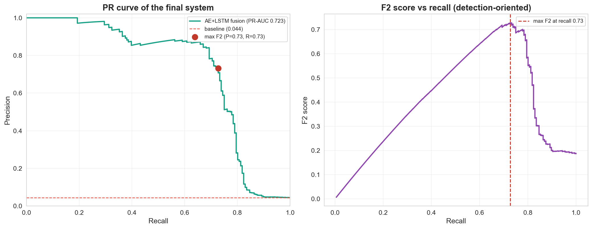
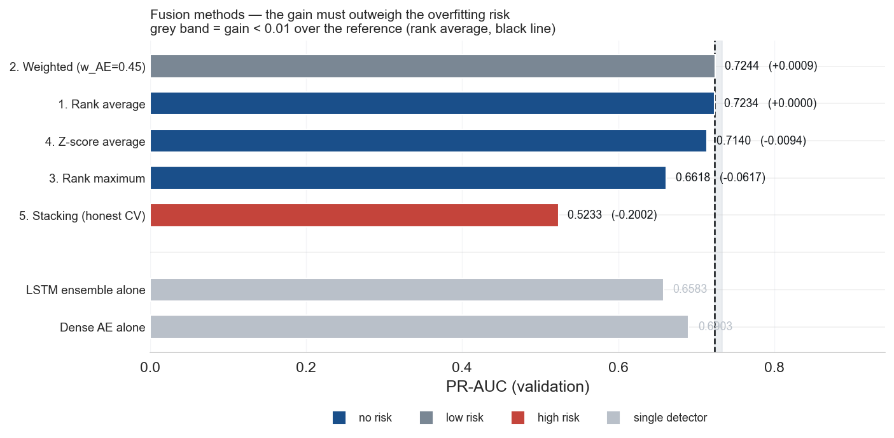

# Predictive Maintenance for Photovoltaic Systems

**Unsupervised** anomaly detection on PV measurements in near real time: an ensemble of autoencoders and an ensemble of LSTMs, fused by rank averaging, feed a Grafana dashboard and Kafka alarms.

> Final-year engineering project (PFA) — ENSA Agadir, 2026

_Replay of the test set: anomaly score and decision threshold, PV production with detected anomalies, published alerts._

## Why this project

PV faults (shading, degradation, intermittent failures) are rarely labelled in operation. The system learns the **normal behaviour** of the installation from healthy data only, then flags measurements that deviate from it.

## Results

Deployed system: **dense autoencoder (×5) + LSTM (×5)**, rank-average fusion, threshold set on validation (max F2): `fusion_score ≥ 0.946`.

| | Validation | Test |
|---|---|---|
| PR-AUC (point level) | 0.723 | **0.777** |
| Precision | 0.731 | 0.703 |
| Recall | 0.727 | 0.973 |
| Fault episodes detected | 4 / 4 | 3 / 3 |
| Median detection delay | ~0 min | ~0 min |
| Anomaly prevalence (baseline) | 4.4% | 2.6% |

On the test set: 71 true positives, 2 false negatives, 30 false positives, 2,710 true negatives (ROC-AUC 0.996).

### How the model was selected

- All detectors were compared **on validation only**; the test set stayed closed until the final evaluation.
- An Isolation Forest was evaluated and **discarded**: adding it to the fusion lowers PR-AUC (IF+AE+LSTM < AE+LSTM).
- Fusing AE and LSTM adds +0.033 PR-AUC over the AE alone (0.690 → 0.723). More complex variants (weighted average, stacking) were rejected: negligible gain or overfitting risk.

## Limitations

- **The test set contains a single fault type, never seen during development** (3 episodes). The 0.973 recall should be read with caution: validation, with different fault types, gives 0.727.
- **Recall plateaus on validation**: beyond ~0.85 recall, precision drops to the baseline. This is a limit of the system, not a tuning issue.
- Few fault episodes overall: metrics are indicative.
- Trained on a single installation: it must be retrained before use on another site.
- The replayer replays historical data; it does not read physical sensors.

## Architecture

