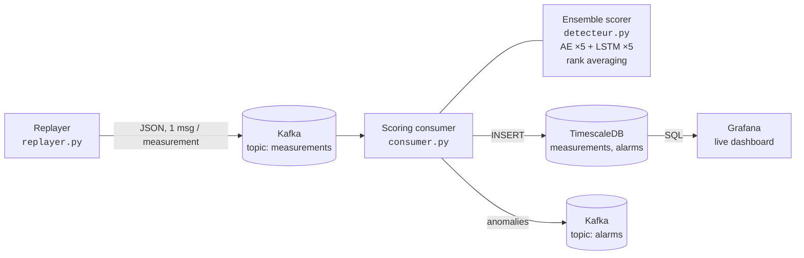

# Photovoltaic Anomaly Detection — Real-Time Predictive Maintenance


Detects faults on a solar plant **without ever training on a labelled fault**, and scores each new measurement as it arrives — from a Kafka stream to a live Grafana dashboard.

**[Read the full case study →](https://mounjimallak-bit.github.io/Portfolio/post/pfa/)** — data exploration, feature selection, model tuning and every decision along the way.


## The problem

Photovoltaic plants fail quietly. Shading, degradation and inverter faults do not stop production; they bend it down by a few percent, for days, until someone notices. Labelled fault archives are rare, so a supervised classifier is not an option in practice.

This system learns what a **healthy plant** looks like, and raises an alarm when live measurements depart from it.

## Highlights

- **Unsupervised** — models are trained on healthy data only; labels are used solely to pick the alert threshold and to report results.
- **Streaming-ready** — each 5-minute measurement is scored on its own, against a frozen reference, so the score is identical offline and in production.
- **Ensemble of 10 networks** — 5 dense autoencoders + 5 LSTM autoencoders, fused by rank averaging.
- **Honest evaluation** — chronological split, model selection on validation only, test set opened once at the very end.
- **Full stack in one command** — Kafka, TimescaleDB, Grafana, Kafka UI and pgAdmin via Docker Compose.

## Results

Alert rule: `fusion_score ≥ 0.946` (threshold maximising F2 on validation — a missed fault costs far more than a false alarm).

| | Validation | Test |
|---|:---:|:---:|
| PR-AUC | 0.723 | **0.777** |
| Precision | 0.731 | 0.703 |
| Recall | 0.727 | **0.973** |
| Fault episodes detected | 4 / 4 | **3 / 3** |
| Median detection delay | first measurement | first measurement |

PR-AUC on test is **~30× the random baseline** (anomaly prevalence 2.6%). ROC-AUC on test: 0.996.

## Architecture



## Key design decisions

| Decision | Why |
|---|---|
| Rank against a **frozen reference** distribution | A score computed relative to the current batch looks good offline and is meaningless in production, where the batch is a single point. |
| **AE + LSTM** fusion | The LSTM sees temporal context the dense AE cannot; fusing them adds +0.033 PR-AUC over the best single model. |
| Isolation Forest **removed** | Kept as a baseline, but adding it to the fusion lowered PR-AUC. |
| Simple rank average over stacking | Weighted and stacked fusions gave < 0.01 gain with a real overfitting risk. |
| Threshold on **F2** | Recall matters more than precision for maintenance. |

## Limitations

- The test set contains **a single fault type**, never seen during development. The 0.973 recall should be read with caution — validation, with other fault types, gives 0.727.
- On validation, recall plateaus around 0.85: beyond it, precision falls to the baseline.
- Few fault episodes overall, and a single installation: the model must be retrained for another site.
- The replayer streams historical data; it is not connected to physical sensors.

## Quick start

Requirements: Docker, Docker Compose, Python 3.10+.

```bash
git clone https://github.com/mounjimallak-bit/pfa-photovoltaique.git
cd pfa-photovoltaique

# 1. Infrastructure: Kafka, TimescaleDB, Grafana, Kafka UI, pgAdmin
docker compose up -d

# 2. Python environment
python -m venv .venv && source .venv/bin/activate
pip install -r requirements.txt

# 3. Start the scoring consumer, then the replayer (two terminals)
python src/consumer.py
python src/replayer.py
```

| Service | URL |
|---|---|
| Grafana | http://localhost:3000 (`admin` / `admin` — change it) |
| Kafka UI | http://localhost:8090 |
| pgAdmin | http://localhost:5050 |

## Project structure

```
├── src/
│   ├── replayer.py       streams the test set into Kafka
│   ├── consumer.py       scores each measurement, writes to DB and alarms
│   ├── detecteur.py      AE + LSTM ensemble and rank fusion
│   └── db.py             TimescaleDB access
├── model_final/          trained models, scalers, reference scores, config.json
├── notebooks/final.ipynb full analysis: EDA, ablations, tuning, evaluation
├── docker/               SQL schema and migrations
├── grafana/              provisioned dashboard and datasource
└── docker-compose.yml
```

## Tech stack

Python · TensorFlow / Keras · scikit-learn · pandas · Apache Kafka · PostgreSQL / TimescaleDB · Grafana · Docker Compose

## Author

**Malak Mounji** — final-year engineering student in Data Science, Big Data & AI, ENSA Agadir.
[Portfolio](https://mounjimallak-bit.github.io/Portfolio/) · [LinkedIn](https://www.linkedin.com/in/malakmounji/)
