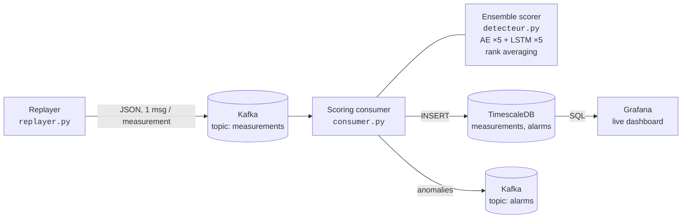

# Photovoltaic Anomaly Detection: Real-Time Predictive Maintenance


Detects shading faults on a solar plant by learning **healthy behaviour only** (fault rows are removed from training using the labels, see *Semi-supervised* below), and scores each new measurement as it arrives, from a Kafka stream to a live Grafana dashboard.

**[Read the full case study →](https://mounjimallak-bit.github.io/Portfolio/post/pfa/)**: data exploration, feature selection, model tuning and every decision along the way.


## The problem

Photovoltaic plants fail quietly. Shading and other partial faults do not stop production; they bend it down, for days, until someone notices (the staged faults in this dataset cost about 18% of output). Labelled fault archives are rare, so a supervised classifier is not an option in practice.

This system learns what a **healthy plant** looks like, and raises an alarm when live measurements depart from it.

## Highlights

- **Semi-supervised:** the networks are trained on healthy data only, but labels are used beyond the threshold: to remove fault rows from training, to select features, to tune hyperparameters, to choose the fusion and the threshold, and to report results.
- **Streaming-ready:** each 5-minute measurement is scored on its own, against a frozen reference, so the score is identical offline and in production.
- **Ensemble of 10 networks:** 5 dense autoencoders + 5 LSTM autoencoders, fused by rank averaging.
- **Clean evaluation:** chronological split, model selection and threshold on validation only; the deployed system was frozen before the test set was opened. Later analyses (sections 16–17) reuse the test set for comparison only and change nothing in `model_final/`.
- **Full stack in one command:** Kafka, TimescaleDB, Grafana, Kafka UI and pgAdmin via Docker Compose.

## Results

Alert rule: `fusion_score ≥ 0.946` (threshold maximising F2 on validation, because a missed fault costs far more than a false alarm).

| | Validation | Test |
|---|:---:|:---:|
| PR-AUC | 0.723 | **0.777** |
| Precision | 0.731 | 0.703 |
| Recall | 0.727 | **0.973** |
| Fault episodes detected | 4 / 4 | **3 / 3** |
| Median detection delay | first measurement | first measurement |

PR-AUC on test is **~30× the random baseline** (anomaly prevalence 2.6%). ROC-AUC on test: 0.996.

## Data

Public dataset from [Zenodo, record 7828879](https://zenodo.org/records/7828879) (version 3), described in Graillet et al., "Electrical production data of a domestic grid-connected rooftop PV plant in normal and shading faults conditions associated with solar and meteorological data in a tropical climate", *Data in Brief* 46 (2023) 108723, [doi:10.1016/j.dib.2022.108723](https://doi.org/10.1016/j.dib.2022.108723): a 4 kW domestic PV installation in La Réunion, with meteorological and electrical measurements and labelled shading faults (uniform, partial on 1 to 3 modules, partial on part of a module, intermittent). It was provided by the internship supervisor.

The two raw CSV files (2.3 GB) are not versioned. Only their 5-minute merge, `data/merged_5min_day.csv`, is in the repository, and the notebook reloads it automatically. To rerun the raw-data sections, download these two files into `data/`:

- `dt1_solar_and_meteorological_measurement.csv`
- `dt2_electrical_production_inverter_1_with_faults.csv`

## Architecture



## Key design decisions

| Decision | Why |
|---|---|
| Rank against a **frozen reference** distribution | A score computed relative to the current batch looks good offline and is meaningless in production, where the batch is a single point. |
| **AE + LSTM** fusion | The LSTM was meant to add temporal context; fusing them adds +0.033 PR-AUC on validation, a gap of the order of seed-to-seed noise. On test the LSTM family alone scores 0.27, so the test result is carried by the dense autoencoders. |
| Isolation Forest **removed** | Kept as a baseline; adding it to the fusion lowered validation PR-AUC (0.723 → 0.687), again within noise on four validation episodes. |
| Simple rank average over stacking | Weighted and stacked fusions gave < 0.01 gain with a real overfitting risk. |
| Threshold on **F2** | Recall matters more than precision for maintenance. |

## Limitations

- The test set contains **a single fault sub-type (F3.1)**, absent from development but a near-twin of F3.2, which is in validation. It is three repeats of one staged experiment: 3/3 episodes gives a 95% interval of 0.29–1.00 on the detection rate, and a day-level bootstrap puts test PR-AUC between 0.48 and 0.94.
- **Simple baselines are competitive.** A 10-nearest-neighbour distance on the six raw sensors scores 0.64 on validation and 0.88 on test (ensemble: 0.72 and 0.78). Neither difference is established: ROC-AUC is identical (0.997 vs 0.996), the test PR-AUC gap comes from six healthy early-morning points (removing them gives 0.97 for the ensemble), and a kNN chosen on validation with the ensemble's own rule scores 0.70 on test. Over the 17 incidents, no method differs from kNN. At equal performance, kNN is about 140 times cheaper and needs no training.
- **Dawn points decide the scores.** The LSTM needs six consecutive points, so the first five points of each day are never scored, by any method in the comparison. These are mostly healthy dawn points with low sun. Scored on all test points, kNN drops from 0.88 to 0.39 and the dense autoencoder alone from 0.75 to 0.34. In the deployed system the LSTM window therefore acts as an implicit dawn mask.
- **Seasons.** Training covers late spring and summer only. On the 10.5 fault-free months after the study period, the deployed threshold raises about 2.6 false-alarm events a week overall, and 4–11 a week from June to September (austral winter).
- On validation, recall plateaus around 0.85: beyond it, precision falls to the baseline.
- **The threshold is the most label-dependent choice.** All 73 test fault points score between 0.88 and 0.969; the deployed threshold (0.946, F2 on validation) sits just below. A label-free rule flagging 2% of unlabelled validation, or a budget of one alarm event per week, detects none of the three test episodes; a budget of two events per week detects all three.
- **Validation scores are optimistic.** Features, hyperparameters, fusion and threshold were all chosen on the same four validation incidents (over 130 configurations compared), so validation metrics are post-selection estimates. The leave-one-incident-out study (section 17) is the less biased evidence; its April folds share incidents with the selection.
- Few fault episodes overall (4 in validation, 3 in test), all staged shading, and a single installation: the model must be retrained for another site.
- The operating point depends on the seeds: retraining with five other seeds moves the threshold and lowers test precision.
- The replayer streams historical data; it is not connected to physical sensors.
- Delivery is at-least-once. Database writes are idempotent (upsert by timestamp); the `alarms` topic can receive a duplicate after a crash between publication and offset commit, identifiable by its key (the measurement timestamp).
- Kafka runs without a persistent volume: `docker compose down` clears the alarms topic; the database is the system of record.
- **Sample size.** Three test episodes of one fault sub-type cannot measure a detection rate (95% interval 0.29–1.00). See [Experimental design and sample size](docs/experimental_design.md) for the unit of analysis, the minimal relevant differences and the number of episodes a conclusive study would need.
## Quick start

Requirements: Docker, Docker Compose, Python 3.10+.

```bash
git clone https://github.com/mounjimallak-bit/pfa-photovoltaique.git
cd pfa-photovoltaique
# 0. Local settings: copy the example file, then replace every "change-me" value
cp .env.example .env
# 1. Infrastructure: Kafka, TimescaleDB, Grafana, Kafka UI, pgAdmin
docker compose up -d


# 2. Python environment
python -m venv .venv && source .venv/bin/activate
pip install -r requirements.txt
# All components (consumer, replayer, docker compose) read the same .env through src/config.py.
# 3. Start the scoring consumer, then the replayer (two terminals)
until python src/consumer.py; do echo "consumer stopped, restarting in 5 s"; sleep 5; done
python src/replayer.py
```
The consumer stops on purpose, without committing, if the database or Kafka does not confirm a write; the loop restarts it and the message is processed again.
Tests of the consumer's message handling (no Kafka or database needed; they replay part of the test partition and compare with the batch scores):

```bash
pip install pytest
python -m pytest tests/ -v
```

| Service | URL |
|---|---|
| Grafana | http://localhost:3000 (`admin` / value of `GRAFANA_ADMIN_PASSWORD` in `.env`) |
| Kafka UI | http://localhost:8090 |
| pgAdmin | http://localhost:5050 |

## Reproducing the results

| Level | What it reproduces | How | Time |
|---|---|---|---|
| 1 | Every number of the notebook (sections 2 to 17), from the versioned caches and models | Run All with the default flags | ~5 to 15 min (CPU) |
| 2 | Tuning grids, final models, seed sensitivity, leave-one-incident-out | Set `FORCER_RECALCUL`, `RUN_TRAINING`, `RUN_RETRAIN` or `RUN_LOIO` to `True` | 1 to 9 h each |
| 3 | Section 1 and the 5-minute merge | Download the two Zenodo CSVs into `data/` | +2.3 GB |

The committed notebook is a single run (cells numbered 1 to 106), executed with the exact
environment that produced `model_final/` (`requirements-notebook.txt`): the recomputed rank
references match the delivered ones bit for bit. A Run All never modifies `model_final/`: it checks
references, threshold and test decisions against the delivered files (`ECRIRE_MODEL_FINAL = False`).
`model_final/MANIFEST.json` records how the models were trained (parameters, seeds, versions, data)
and the SHA-256 of every versioned artefact; `tests/test_manifeste.py` checks it. Retraining
(level 2) is deterministic on a given machine and library versions, but does not reproduce the
delivered weights bit for bit: section 16.7 measures the seed-to-seed variation this implies.

## Project structure

```
├── src/
│   ├── replayer.py       streams the test set into Kafka
│   ├── consumer.py       scores each measurement, writes to DB and alarms
│   ├── detecteur.py      AE + LSTM ensemble and rank fusion
│   └── db.py             TimescaleDB access
├── model_final/          trained models, scalers, reference scores, config.json
├── notebooks/final.ipynb full analysis: EDA, ablations, tuning, evaluation
├── analysis/             read-only diagnostics (knn_vs_ensemble.py, sample_size.py)
├── docs/                 experimental design and sample size considerations
├── tests/                consumer message handling vs batch scores
├── docker/               SQL schema and migrations
├── grafana/              provisioned dashboard and datasource
└── docker-compose.yml
```

## Tech stack

Python · TensorFlow / Keras · scikit-learn · pandas · Apache Kafka · PostgreSQL / TimescaleDB · Grafana · Docker Compose

## Author

**Malak Mounji**, engineering student in Data Science, Big Data & AI at ENSA Agadir. Summer internship (PFA) at Albarray Consulting, July to August 2026.
[Portfolio](https://mounjimallak-bit.github.io/Portfolio/) · [LinkedIn](https://www.linkedin.com/in/malakmounji/)
